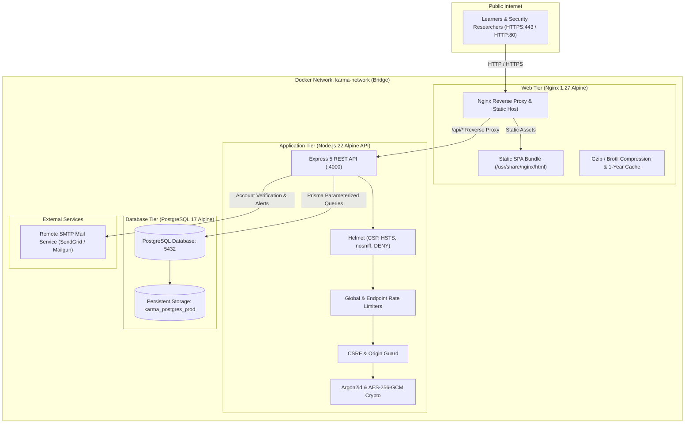

# Karma's World

> **Learn. Practice. Explore. Master Cybersecurity.**  
> A completely free, modern, interactive, and scalable cybersecurity education platform.

---

## 1. Project Vision & Philosophy

**Karma's World** is a free cybersecurity learning ecosystem designed to make high-quality cybersecurity education accessible to everyone — from absolute beginners to advanced practitioners, students, ethical hackers, SOC analysts, and security researchers.

The platform combines the best aspects of:
- **Udemy**: Structured courses, comprehensive curricula, and modular learning paths.
- **TryHackMe**: Hands-on, practical cybersecurity learning and guided exercises.
- **Hack The Box**: Real-world technical challenges and skill milestones.
- **Duolingo**: Gamification, learning streaks, XP, badges, and motivation.
- **GitHub**: Developer-oriented resources and transparent community learning.
- **Interactive Visualizers**: Browser simulations, OSI/TCP-IP models, packet flow, and cryptographic demonstrations.

**Pricing Model:** Completely Free for learners worldwide.

---

## 2. Technology Stack

- **Frontend:** React 18, TypeScript, Vite, Tailwind CSS, Lucide Icons, Vitest.
- **Backend:** Node.js, Express 5, TypeScript, REST API, Zod schema validation.
- **Database & State:** PostgreSQL, Prisma ORM, Server-Side Session store (`connect-pg-simple`), Redis-ready.
- **Security & Auth:** Argon2id password hashing, CSRF tokens, Helmet security headers, rate limiting, SameSite secure cookies, optional TOTP two-step verification with encrypted secrets at rest, recovery codes, and session revocation.
- **Monorepo Management:** pnpm workspaces, TypeScript project references.
- **Local Infrastructure:** Docker Compose (PostgreSQL 17, Mailpit local SMTP).

---

## 3. Project Architecture

The platform is structured as a modular monolith within a pnpm monorepo:

```text
karmas-world/
├── .github/
│   └── workflows/
│       └── ci.yml             # GitHub Actions CI workflow (lint, test, build)
├── docs/
│   ├── architecture.md       # Platform architecture and lab safety boundaries
│   └── development.md        # Local development guidelines
├── packages/
│   └── shared/               # Shared models, enums, constants, and categories
│       ├── src/
│       └── package.json
├── server/                   # Backend Express API module (@karmas-world/api)
│   ├── prisma/               # Prisma schema & PostgreSQL migrations
│   ├── src/                  # Modules: auth, progress, community, leaderboard, news, admin
│   ├── docs/                 # Backend API documentation
│   └── package.json
├── src/                      # Web Frontend application
│   ├── components/           # UI components (Academy, Labs, Games, Dashboard, Dialogs)
│   ├── data/                 # Client state, API clients, and static curricula
│   └── styles/
├── tests/                    # Frontend and shared unit/component tests
├── .env.example              # Root environment configuration template
├── .gitignore                # Git ignore rules
├── .prettierrc               # Code formatting configuration
├── CONTRIBUTING.md           # Contribution guidelines & code of conduct
├── LICENSE                   # MIT License
├── package.json              # Monorepo root scripts & dev dependencies
├── pnpm-workspace.yaml       # pnpm workspace definition
└── vite.config.ts            # Vite & Vitest configuration
```

---

## 4. 12-Phase Development Roadmap

| Phase | Milestone | Status |
|---|---|---|
| **Phase 1** | **Project Initialization (Monorepo, Tooling, CI, Shared, Standards)** | ✅ Complete |
| **Phase 2** | **Frontend Development (Landing, Navigation, 20-Domain Catalog, Course Details, UI)** | ✅ Complete |
| **Phase 3** | **Database & Authentication (Prisma, PostgreSQL, Argon2id, Auth API, TOTP MFA)** | ✅ Complete |
| **Phase 4** | **Learning Management System (20 Categories, Modules, Lessons, Enrollments, Bookmarks)** | ✅ Complete |
| **Phase 5** | **Cybersecurity Labs (Isolated Sandboxes, Linux, Net, Web, Crypto)** | ✅ Complete |
| **Phase 6** | **Gamification (XP, Levels, Ranks, Streaks, Badges, Weekly Missions)** | ✅ Complete |
| **Phase 7** | **Interactive Learning (OSI/TCP-IP Visualizers, Topologies, Monaco)** | ✅ Complete |
| **Phase 8** | **Quizzes & Assessments (Timed Exams, Auto-Grading, Explanations)** | ✅ Complete |
| **Phase 9** | **Community & Knowledge Base (Forums, Articles, Moderation)** | ✅ Complete |
| **Phase 10** | **Admin Dashboard (User/Course Management, Analytics, Moderation)** | ✅ Complete |
| **Phase 11** | **Testing & Security Hardening (OWASP Top 10, CSP, HSTS, Sanitization, Audits)** | ✅ Complete |
| **Phase 12** | **Production Deployment & Public Launch (Docker, Nginx, CI/CD, Observability)** | ✅ Complete |

---

## 5. Quickstart & Local Setup

### Prerequisites

- [Node.js](https://nodejs.org/) v20+ or v22+
- [pnpm](https://pnpm.io/) v9+ (or v11+)
- [Docker Desktop](https://www.docker.com/) (for PostgreSQL and Mailpit)
- [Git](https://git-scm.com/)

### Installation

1. **Clone the repository:**
   ```powershell
   git clone https://github.com/adityakashyap/karmas-world.git
   cd karmas-world
   ```

2. **Configure environment variables:**
   ```powershell
   Copy-Item .env.example .env
   Copy-Item server/.env.example server/.env
   ```
   *Edit `server/.env` to supply a secure random `SESSION_SECRET` (at least 32 characters).*

3. **Install dependencies:**
   ```powershell
   pnpm install
   ```

4. **Start local backing services:**
   ```powershell
   docker compose up -d database mailpit
   ```

5. **Generate Prisma client and apply database migrations:**
   ```powershell
   pnpm --filter @karmas-world/api db:deploy
   ```

6. **Start development servers:**
   ```powershell
   # Terminal 1 - Frontend (Vite) at http://localhost:5173
   pnpm dev

   # Terminal 2 - Backend API at http://localhost:4000
   pnpm api:dev
   ```

---

## 6. Quality Checks & Verification

Run all test suites and builds locally before committing:

```powershell
# Build shared package
pnpm shared:build

# Run frontend & shared tests (29 test files, 105 tests)
pnpm test

# Build frontend production bundle
pnpm build

# Run backend API tests (18 test files, 117 tests)
pnpm api:test

# Build backend API
pnpm api:build

# Run all tests (47 suites, 222 tests) and build all workspaces
pnpm test:all
pnpm build:all
```

---

## 7. Production Deployment & Public Launch Architecture (Phase 12)

### 7.1 Multi-Container Topology



### 7.2 Production Quickstart with Docker Compose

1. **Configure Production Environment Secrets:**
   ```powershell
   Copy-Item .env.production.example .env.production
   # Edit .env.production with strong cryptographically random keys
   ```

2. **Build and Launch Containerized Services:**
   ```powershell
   docker compose -f docker-compose.prod.yml up -d --build
   ```

3. **Apply Database Migrations:**
   ```powershell
   docker compose -f docker-compose.prod.yml exec api pnpm --filter @karmas-world/api db:deploy
   ```

4. **Verify Container Health Status:**
   ```powershell
   docker compose -f docker-compose.prod.yml ps
   # Test API Health Endpoint
   Invoke-RestMethod -Uri http://localhost/api/health
   ```

### 7.3 Zero-Downtime Rolling Update SOP

To deploy application updates without service downtime:

```powershell
# Pull latest code
git pull origin main

# Rebuild images in background
docker compose -f docker-compose.prod.yml build

# Apply any new database migrations
docker compose -f docker-compose.prod.yml exec api pnpm --filter @karmas-world/api db:deploy

# Recreate API container smoothly
docker compose -f docker-compose.prod.yml up -d --no-deps --build api

# Recreate Frontend Nginx container smoothly
docker compose -f docker-compose.prod.yml up -d --no-deps --build web
```

### 7.4 Disaster Recovery & Backup SOP

1. **Automated Database Backup:**
   ```powershell
   docker compose -f docker-compose.prod.yml exec -t database pg_dump -U karma karmas_world > "backup_$(Get-Date -Format 'yyyyMMdd_HHmmss').sql"
   ```

2. **Database Restore:**
   ```powershell
   Get-Content backup_20261126_010000.sql | docker compose -f docker-compose.prod.yml exec -T database psql -U karma karmas_world
   ```

---

## 8. Security & Safe Lab Principles

Because Karma's World is a cybersecurity education platform, we enforce defense-in-depth:

- **Isolated Environments:** Learner-supplied commands or payloads are never executed on the host server. Practice labs operate as browser-only simulations or isolated, short-lived, least-privilege containers.
- **Zero Secret Commits:** Secrets, encryption keys, and environment files are strictly excluded via `.gitignore`.
- **Full Input Validation:** All API inputs are strictly validated via Zod schemas and parameterized database access with Prisma.
- **Session Protection:** Secure SameSite HTTP-only cookies, CSRF validation on all state-changing endpoints, and automatic session rotation upon password changes.

---

## 9. License

This project is licensed under the [MIT License](LICENSE).  
Copyright (c) 2026 Aditya Kashyap.
